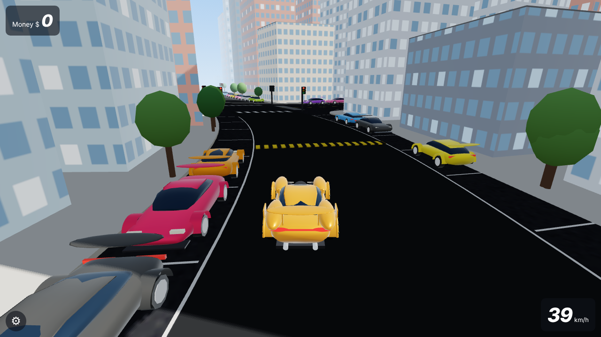
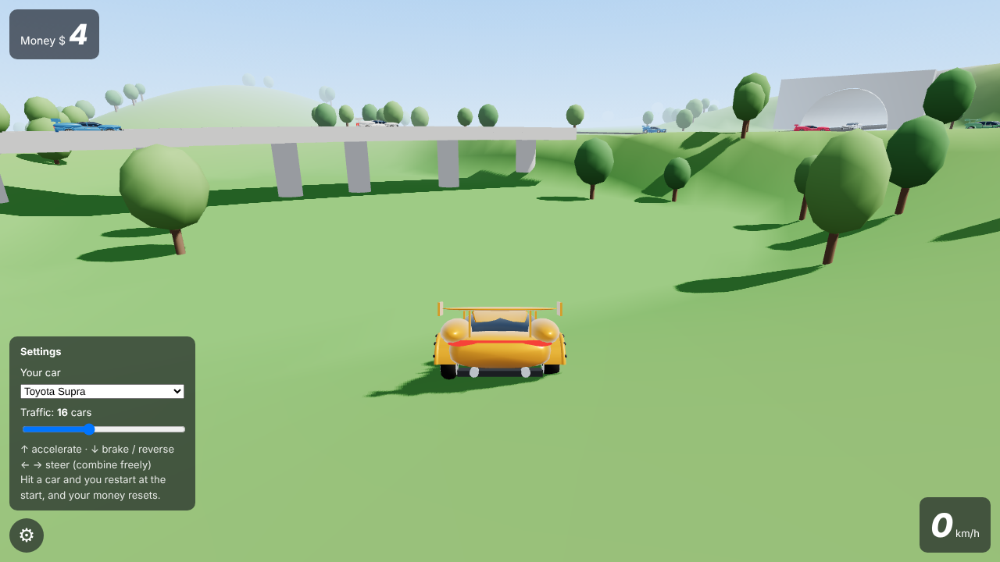

# Rocket Bunny City Drive

A browser driving game. Drive a sports car through an endless, self-generating world:
a city of towers, traffic lights and parked cars; rivers with ramped bridges; then highways with hills,
tunnels, bridges and sweeping interchanges; a desert; and the next city. Hit another car and you restart at the
start line with your money reset to zero.




## Play

The game is plain ES modules with no build step, but browsers refuse to load modules from `file://`, so it needs
to be served over http:

```
npm start            # serves the repo at http://localhost:8080/ (Node 22 was used for development and CI; no installs needed)
```

or turn on **GitHub Pages** for this repo (Settings → Pages → Deploy from branch → `main` / root) and open the
Pages URL. Any static file server works too.

### Controls

| Key | Action |
| --- | --- |
| ↑ | Accelerate |
| ↓ | Brake, then reverse |
| ← → | Steer (combine freely with ↑ / ↓) |
| Space | Change car: the game blurs out and a 3D model of a car turns slowly on a podium. ← → move through the cars like a carousel, Space chooses the one on show, Esc cancels. The game (and the sound) is paused while it is open |
| C | Switch camera: chase view / cockpit view (the driver's eye, behind the steering wheel) |
| ⚙ (bottom left) | Settings: the amount of traffic, sound on/off and volume |

Cars: every vehicle in the game is a 3D model loaded from `assets/models/` (nothing is built in code; sources and licences are in that folder's README). You choose between a Ferrari 458 Italia (with a modelled cockpit whose steering wheel turns), a Nissan GT-R R35 Liberty Walk, a 1965 Ford Mustang Fastback, a Toyota Camry, a Tesla Model S, an Audi RS6 Avant, a BMW M4 and a Volkswagen Golf. Traffic and the kerbside parked cars are a mix of the Camry, Tesla, Audi, BMW and Golf in different colours. **C** switches between the chase view and the driver's view, which is available in the Ferrari only (the others stay in the chase view). Cars are drawn at three levels of detail by distance, so distant cars cost very little, and parked cars are drawn for the slots nearest you (a pool of 48, `src/traffic/parkedManager.js`).

## Sound

All sound is synthesised live with the browser's Web Audio API (`src/audio.js`); there are no audio files and no
dependencies.

- **Engine:** pitch follows your speed through a gearbox (it climbs, then drops at each shift) and is duller when you lift off the throttle. **Each car has its own voice** (`SOUNDS` in `src/config.js`): the Mustang is a low, lumpy, loud V8 burble; the Nissan is beefy with a turbo whistle; the Ferrari revs highest and brightest; the Camry and Golf are gentle; the Audi and BMW sit in between; and the Tesla has no engine at all, just a rising electric whine, silent when stopped, with more tyre noise. The voice changes when you choose a different car.
  duller when you lift off the throttle.
- **Road and wind:** road noise and wind grow with speed and stop while you are airborne; tyres squeal when you
  corner or brake hard at speed.
- **Ambience:** a bed for each environment (city rumble, countryside wind and birds, desert wind) that crossfades
  as you drive between them.
- **Impacts:** a crash, a building thud (louder the harder you hit), a speed-bump thump and a landing.

Browsers only allow sound after you press a key or click, so it starts on your first key press. The Sound
checkbox and Volume slider are in the settings panel. Sound also pauses while the tab is hidden.

## What is in the world

- Perimeter roads: wherever a city block borders a highway ring it gets a real road (surface, centre dashes) with a proper junction where highway roads arrive.
- Cities: bent (not ruler-straight) roads, four road styles, traffic lights, kerbside parking, speed bumps,
  petrol stations, rounded footpaths, rivers crossed by ramped bridges.
- Highways: rolling hills, tunnels, bridges, interchanges, faster traffic. Highway rings alternate between green
  country and desert.
- The world repeats a 12-ring pattern outwards (6 city rings, 6 highway rings), so the next city appears after a
  stretch of highway. Every cell is generated deterministically from its grid position, so it looks the same
  each time you return.

## Project layout

```
index.html              page shell + import map (three -> vendor/three)
styles/game.css
src/
  main.js               entry point: builds the Game, shows a fatal-error overlay if something throws
  game.js               Game: owns the systems below, runs the loop, decides what a crash means
  config.js             every tunable number (physics, traffic, camera, world size, car list, key map)
  input.js              InputManager: keyboard -> { throttle, brake, steer }; extra sources can be added
  camera.js             ChaseCamera: chase view and cockpit view (C)
  renderer.js           WebGL renderer setup
  environment.js        sky, sun + shadows, fog, ground
  assets.js             materials and procedural textures
  audio.js              AudioManager: procedural engine, road, ambience and impact sounds
  collisions.js         blocks, bumps, parked cars, traffic
  vehicles/             the car library (loads and builds every vehicle from glTF files, with distance detail levels), player car + physics
  traffic/              TrafficManager: lanes, turns, following, traffic lights, recycling
  world/                zones (pure world-shape functions), cell generators, trees, chunk streaming, signals
  ui/                   HUD, settings panel and the car selector (Space)
  util/                 seeded RNG, maths, geometry Batcher
tests/                  Node tests (zones, whole-game integration) + browser smoke test
tools/serve.mjs         tiny static server used by `npm start` and the browser test
vendor/three/           three.js r128 (ES module build, BufferGeometryUtils, GLTFLoader, DRACOLoader + decoder, SkeletonUtils), MIT licensed
assets/models/         the glTF car library (see its README for sources and licences)
tools/car-pipeline/    offline scripts that turned big car models into the game-ready files
```

## How it works

- **Independent systems.** The `Game` object wires together the player car, camera, environment, collisions,
  traffic, chunk streaming, signals, input, HUD and settings panel. Each can be constructed on its own, and
  `Game` accepts injected dependencies (renderer, input, HUD, settings) — that is how the tests run the whole game
  with no GPU.
- **Grid space and world space.** Roads, zones and traffic logic run on a straight grid of 100-unit cells. What
  you see and drive on is that grid *warped* by smooth functions (`toWorld` / `toGrid` in `world/zones.js`), which
  gives curved roads without changing the logic. The player lives in world space and keeps its grid position in
  sync for anything that thinks in cells.
- **Streaming.** `ChunkManager` keeps the 7×7 cells around the player, builds one per frame, and disposes cells
  that fall behind. Static geometry in a cell is merged per material (`util/batcher.js`) to keep draw calls low.
- **Physics.** Arcade-style and deliberately simple: speed, a steering rate that falls off at a crawl and at top
  speed, three collision circles for the car, rounded-rectangle tests for buildings. There is no physics
  engine: the ground is an analytic height function and the game needs no rigid-body dynamics, so an engine would
  add weight without adding anything you can see.
- **Audio.** `AudioManager` is fed the car's state every frame and told about impacts by `Game`. It is inert where Web Audio is missing, and takes an injectable context so it can be tested.
- **Input.** `InputManager.read()` returns `{ throttle, brake, steer }`. A game controller can be added later
  with `input.addSource(() => ({ throttle, brake, steer }))` without touching the car or the game loop.

## Configuration

Everything tunable is in `src/config.js`: top speed, acceleration, braking, steering, camera distance, traffic
density and speeds, signal timing, world size and the zone pattern, the car list and the key map.

## Tests

```
npm test             # Node's built-in runner, no dependencies, ~15 s
npm run test:browser # Playwright + headless Chromium smoke test (see below)
```

`npm test` runs 69 tests:

- the pure world functions (zones, rivers, stations, heights, the warp and its inverse, terrain carved below roads);
- the whole `Game` headless against a stub DOM and a fake renderer: boot, acceleration and money, up+left combining,
  braking distance and reverse, coasting, crashing into a car / a parked car / the river, a car behind you not
  crashing you, building collisions, speed-bump hops, the traffic slider, traffic speed spread and smooth turns,
  traffic lights and cars stopping at red, streaming through highways, desert and the next city, geometry free of
  NaNs across every kind of cell, all five car models, the settings panel, HUD, camera position, input handling
  and a two-minute random-driving soak;
- the audio manager against a fake Web Audio context: engine pitch through the gears, zone detection, the graph
  being built only after a gesture, squeal and ambience logic, birds only in the countryside, one-shot sounds
  and their rate limit, mute and volume, pausing when hidden, and the game triggering the right sound for a crash,
  wall hit, bump and landing.

`npm run test:browser` starts the server, opens the game in headless Chromium, checks that the world streams in,
the canvas is not blank, ↑ and ↑+← work, the settings panel and car selection work, the highway and second city
stream in, and there are no console errors. It also measures the real Web Audio output with an analyser: idle is
audible, the output is louder and the engine note higher at speed (about 32 Hz idling, 161 Hz at 45 m/s), muting
silences it, and a crash is a loud event. It saves screenshots to `tests/browser/out/`. Playwright is not a
project dependency (the game has none); install it with `npm i -D playwright && npx playwright install chromium`.

### What the tests do not show

- Rendering is verified only by software WebGL (SwiftShader) in headless Chromium, which runs at a few frames per
  second. **Real-GPU frame rate has not been measured.** The performance work (merged geometry, 49-cell streaming,
  shadow map refreshed every second frame, shared lamp materials) is by design, not by benchmark.
- Visual quality was checked by looking at screenshots, not by automated image comparison.
- Only Chromium has been tried. Firefox and Safari are untested.
- There is no automated test for how the car *feels* to drive, or for how the **sound** actually sounds. The audio
  tests show the synthesis responds correctly to the game; they cannot judge whether it is pleasant or realistic.
  The sounds are simple synthesis and have only been checked by measurement, never listened to.

## Differences from the single-file version

This is a port, not a redesign: the look, world and controls are meant to be the same. Deliberate changes:

- `toGrid` (world to grid) now uses Newton's method. The original's three fixed-point iterations were off by up to
  ~3 units in cities and ~10 on highways; it is now accurate to about 0.003.
- Chunk loading, speed-bump lookup and traffic spawning consistently use grid coordinates (the original mixed
  world and grid coordinates, which was only roughly right where the warp is strong).
- Fewer per-frame allocations, HUD writes only when a value changes, geometry merging falls back to separate
  meshes instead of failing, and replaced car models are disposed.

## Known limitations

- No horn, siren, music or sound for traffic cars, and no minimap or touch controls yet.
- The sound settings are not remembered between visits.
- Any crash (traffic, parked car, river) simply restarts you; there is no damage model.
- Traffic only drives on straight grid lines and Bezier turns; there is no overtaking.

## Upgrading three.js

`vendor/three/README.md` explains the vendoring. The one API change to expect: `mergeBufferGeometries` became
`mergeGeometries` in r151 (used in `src/util/batcher.js`).
